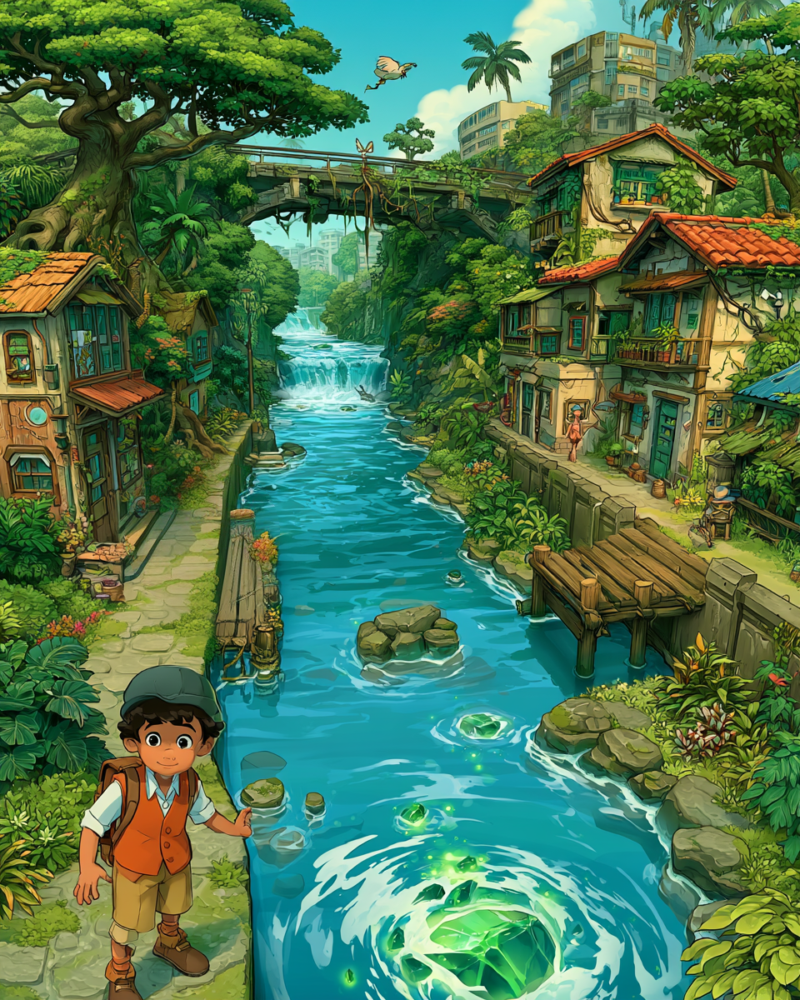

# 📜《瓦磘溝探索之旅》角色設定集（Character Sheet & Model Bible）

> **專案名稱**：志同道河 River Adventure Project ｜ 瓦磘溝環境守護教育遊戲  
> **美術風格規範**：日系吉卜力手繪繪本風（Studio Ghibli Watercolor）、新海誠清新光影、立體泥塑感（Claymorphism）、溫暖自然色調。  
> **目標客群**：國小三至六年級學童、環境教育教師、親子導讀走讀團體。

---

## 目錄
1. [角色 1：小探險家（The Young Explorer / 阿倫）](#角色-1小探險家the-young-explorer--阿倫)
2. [角色 2：小水滴（Water Drop）](#角色-2小水滴water-drop)
3. [角色 3：河爺爺（River Grandpa）](#角色-3河爺爺river-grandpa)
4. [角色 4：小白鷺（Little Egret）](#角色-4小白鷺little-egret)
5. [角色 5：醜泥怪 ➔ 泥土精靈（Mud Monster & Cleaned Mud Sprite）](#角色-5醜泥怪--泥土精靈mud-monster--cleaned-mud-sprite)
6. [Midjourney v6 角色設定圖（Character Sheet）生成提示詞專區](#ai-生圖-midjourney-v6-prompt-指南)

---

## 角色 1：小探險家（The Young Explorer / 阿倫）



### 一、 基本檔案
* **中文姓名**：阿倫（小探險家，代表玩家視角）
* **英文代號**：The Young Explorer (Allen)
* **年齡 / 年級**：10 歲（國小四年級）
* **性格特質**：好奇心旺盛、善良、敏於觀察、具備行動力與正義感。
* **口頭禪**：*「河流在呼喚我們，一起找出真相吧！」*
* **色彩規範**：
  * **主色（探險背心）**：暖橘紅 `#E65100` / `#F57C00`
  * **輔色（工裝短褲）**：復古淺卡其 `#E0D4B8` / `#F5F5DC`
  * **頭飾（復古帽子）**：墨綠石板色 `#2E4A43` / `#1B3B36`
  * **點綴色（皮帶/短靴）**：深皮革棕 `#5D4037`

### 二、 外觀視覺規格（Visual Specs）
* **身型比例**：約 3.5 ～ 4 頭身，健康敏捷的少年體態，略帶童稚圓潤感。
* **面部特徵**：
  * 髮型：深黑棕色微捲蓬鬆短髮，前額露出一小撮碎髮。
  * 眼睛：深褐大眼，明亮清澈，帶著反光的高光圓點。
  * 膚色：微曬的健康小麥膚色，透著自然紅潤。
* **服裝與配件拆解**：
  1. **復古報童鴨舌帽**：墨綠石板棉麻材質，軟頂硬簷，微微向後戴。
  2. **內搭襯衫**：米白色短袖開襟棉麻襯衫，翻領微敞。
  3. **探險背心**：暖橘色多功能背心，左右各有掀蓋口袋，木質圓形鈕扣。
  4. **工裝短褲**：卡其色膝上短褲，兩側有工裝大口袋，便於涉水穿行。
  5. **鞋襪**：米白粗針織短襪（略微自然堆疊）+ 深棕色真皮復古登山短靴。
  6. **探險裝備**：斜背小水壺、背後背著深棕色雙肩帆布背包，背包外側掛著一支黃銅色指南針。

### 三、 表情與動作矩陣（Expressions & Poses）
* **表情 1（常規/微笑）**：嘴角微翹，眼神專注溫暖。
* **表情 2（驚奇/發現）**：眼睛睜大，嘴型呈「O」字，單手食指指向水底晶石。
* **表情 3（思考/解謎）**：單手托腮微偏頭，眉頭微蹙，注視線索卡。
* **表情 4（堅定/守護）**：握拳於胸前，眼神堅定，展現保護家鄉河川的決心。

---

## 角色 2：小水滴（Water Drop）

### 一、 基本檔案
* **中文姓名**：小水滴
* **英文代號**：Water Drop
* **身分定位**：瓦磘溝「記憶之流」的化身、遊戲核心引路夥伴
* **性格特質**：溫柔純真、情感豐富、深愛瓦磘溝、堅韌不放棄。
* **口頭禪**：*「只要還有人願意記得，河流的故事就不會消失。」*
* **色彩規範**：
  * **純淨水藍（本體漸層）**：`#81D4FA`（頂部高光）至 `#0288D1`（底部深邃藍）
  * **高光光暈**：純白 `#FFFFFF` (80% 不透明度)
  * **害羞腮紅**：櫻花粉 `#FF80AB` (60% 不透明度)
  * **受污染狀態**：濁灰藍 `#78909C`、沉積灰 `#546E7A`

### 二、 外觀視覺規格（Visual Specs）
* **身型比例**：約 1.5 ～ 2 頭身，水滴狀流體造型，無骨骼，彈性質感。
* **面部特徵**：
  * 水汪汪的深藍大眼睛，兩頰有橢圓形粉紅腮紅。
  * 靈動的弧線嘴形，隨語調自然開闔。
  * 身軀左上方帶有一道斜向橢圓晶瑩高光。
* **狀態演變（Gameplay States）**：
  * **【序章】混濁微光**：水體偏灰濁，光芒飄忽微弱，頭部水尖下垂。
  * **【第一章】金色共鳴**：尋獲【歷史之石】，核心浮現金色齒輪與水波光點。
  * **【第二章】翠綠生機**：尋獲【生態之葉】，周圍環繞綠色微葉光點，身形變得飽滿。
  * **【第三章】澄澈甦醒**：尋獲【守護之水】，通體散發湛藍純淨鑽石高光，身後帶有水滴拖尾粒子。

---

## 角色 3：河爺爺（River Grandpa）

### 一、 基本檔案
* **中文姓名**：河爺爺
* **英文代號**：River Grandpa
* **身分定位**：瓦磘溝千年河川守護靈、智者導師
* **性格特質**：慈祥睿智、幽默溫暖、博古通今、守護土地。
* **口頭禪**：*「河流會記得每一件發生過的事情。」*
* **色彩規範**：
  * **水靈長袍**：青瓷深綠 `#2E7D32`、碧綠 `#00897B`
  * **白浪長鬚**：純白 `#FFFFFF`、水沫青 `#E8F8F5`
  * **守護靈珠**：翡翠螢光綠 `#00E676`
  * **木杖木紋**：老樹皮褐 `#5D4037`

### 二、 外觀視覺規格（Visual Specs）
* **身型比例**：約 3 頭身，圓潤微胖的長者身形，自帶浮空感，腳下常泛起微型水雲。
* **面部特徵**：
  * 白色的長眉毛向上微翹，雙眼瞇成慈祥彎月。
  * 茂密如同瀑布浪花般的白色水波長鬚，垂至胸前。
  * 額前有清涼舒暢的靈水光暈。
* **服裝與標誌道具**：
  1. **水草冠飾**：由水柳葉與香蒲編織而成的長老額冠，正中鑲嵌一顆發光的翠綠靈珠。
  2. **水紋道袍**：寬鬆的綠波長袍，袍邊飾有古代雙和水路傳統水紋繡邊。
  3. **時光水草木杖**：老榕樹氣根自然生長雕琢而成的長手杖，頂端懸掛一顆發光的記憶晶球與小巧黃銅風鈴，輕敲地面會激盪水光漣漪。

---

## 角色 4：小白鷺（Little Egret）

### 一、 基本檔案
* **中文姓名**：小白鷺
* **英文代號**：Little Egret
* **身分定位**：瓦磘溝河川生態觀察員、鳥類代表、活潑偵探
* **性格特質**：機警敏銳、活潑好動、話匣子、熱心助人、愛吃小魚蝦。
* **口頭禪**：*「咦？你有看到那個奇怪的東西嗎？」*
* **色彩規範**：
  * **羽毛主色**：雪白 `#FFFFFF`、羽毛陰影灰藍 `#CFD8DC`
  * **鳥喙與腳爪**：亮黃橙色 `#FFB300` / `#FFC107`
  * **修長雙腿**：烏木黑 `#212121`
  * **背暈光芒**：薄荷水綠 `#E0F2F1`

### 二、 外觀視覺規格（Visual Specs）
* **身型比例**：約 2.5 頭身擬人化鳥類繪本比例。
* **面部與身體特徵**：
  * S 型優美修長的脖頸，身形輕盈敏捷。
  * 頭部後方有兩根細長優雅的繁殖羽（呆毛），興奮或驚訝時會如同天線般立起顫動。
  * 金黃色細長而堅硬的鳥喙。
  * 亮黑色的細長腿部，腳掌為鮮明的明黃色（小白鷺核心特徵「黃足」）。
* **特色動作**：
  * **觀察姿態**：單腳站立於木樁上，脖子微縮，歪頭專注盯著水面。
  * **驚呼姿態**：雙翅大張，頭頂飾羽直豎，喙部微張。
  * **飛行引路**：在小探險家前方盤旋，拍打翅膀灑落點點白羽光塵。

---

## 角色 5：醜泥怪 ➔ 泥土精靈（Mud Monster & Cleaned Mud Sprite）

### 一、 形態一：醜泥怪（The Mud Monster - 前期型態）
* **身分定位**：生活廢棄物與黑臭底泥凝聚的怪物、主要衝突對象
* **性格特質**：調皮頑劣、貪吃垃圾、虛張聲勢、內心孤單渴望被接納。
* **口頭禪**：*「嘿嘿！你們丟下的東西，都是我的力量！」*
* **色彩規範**：
  * **泥體主色**：深泥棕 `#3E2723`、黑泥褐 `#5D4037`
  * **污水氣泡**：沼氣紫棕 `#795548`
  * **垃圾零件**：手搖塑膠藍 `#80DEEA`、爛包裝黃 `#FFF59D`
* **視覺特徵**：
  * 體型約 3.5 ～ 4 頭身，黏稠流體不定形怪獸，隨吞吃垃圾可自由膨大。
  * 身上各處鑲嵌著人類隨意拋棄的垃圾（飲料塑膠杯、破吸管、油污包裝袋）。
  * 凸起的大白眼球，滿口泥漿黑牙，頭頂不斷咕嚕冒出惡臭氣泡。

---

### 二、 形態二：泥土精靈（Cleaned Mud Sprite - 終章淨化型態）
* **身分定位**：洗淨污泥後轉化的瓦磘溝「河川巡邏提醒員」
* **性格特質**：溫厚害羞、熱心誠懇、負責認真、以維護河川清潔為榮。
* **口頭禪**：*「我以後不想再吃垃圾了，我會提醒大家收好水壺和垃圾！」*
* **色彩規範**：
  * **乾淨泥身**：溫潤陶土淺棕 `#8D6E63`
  * **頭頂嫩苗**：翠葉綠 `#4CAF50`、黃綠新芽 `#81C784`
  * **腮紅與微笑**：珊瑚粉 `#FFAB91`
  * **純淨背景**：嫩芽淺青 `#F1F8E9`
* **視覺特徵**：
  * 體積縮小為約 2 頭身，圓滾滾的小陶偶外觀，外表平滑溫暖。
  * 垃圾外殼全部脫落，頭頂中央萌發出兩片鮮綠欲滴的雙子葉幼苗。
  * 純淨的大黑眼睛，臉頰泛起微紅，胸前繫著一條綠色巡守緞帶，神情活潑可愛。

---

## 🎨 AI 生圖 Midjourney v6 Prompt 指南

以下 Prompt 專為生成**高規格角色設定表（Character Sheet / Model Sheet）**打造，包含正側背多視角、多表情集與服裝道具拆解，白底方便美術去背與立繪建模：

### 1. 小探險家（Allen - Character Sheet Prompt）
```text
/imagine prompt: character sheet of a 10-year-old Taiwanese boy explorer named Allen, children's adventure storybook style, Studio Ghibli aesthetic, Makoto Shinkai lighting. The boy is wearing a vintage dark green newsboy cap, a warm orange safari vest with utility pockets over a short-sleeved cream linen shirt, beige cargo shorts, and brown leather hiking boots with white knitted socks. Carrying a brown leather vintage backpack with a brass compass. Includes multiple poses and expressions: front view, side profile, back view, cheerful running pose, thinking pose with hand on chin, happy surprised expression, and smiling standing pose. Clean solid white background, flat vector illustration, soft watercolor shading, high resolution, 8k, full body turnaround --ar 16:9 --v 6.0
```

### 2. 小水滴（Water Drop - Character Sheet Prompt）
```text
/imagine prompt: character model sheet of a cute anthropomorphic water drop spirit, translucent glossy liquid texture, vibrant gradient light cyan to royal blue, shining specular highlights, glowing inner bubbles, blushing cheeks, big expressive dark blue eyes. Storybook fantasy creature, Ghibli style. Multiple emotional states and poses: happy floating pose, sad murky grey polluted droplet with drooping tip, glowing golden empowered state, glowing green leaf floating ring, cheerful waving pose. Solid white background, turnaround reference sheet, clean line art, soft 3D clay shading, isolated character design --ar 16:9 --v 6.0
```

### 3. 河爺爺（River Grandpa - Character Sheet Prompt）
```text
/imagine prompt: character turnaround sheet of an ancient wise and kind river spirit deity named River Grandpa, chibi cute elder style, Studio Ghibli illustration. Flowing pure white cascade waterfall beard reaching chest, friendly smiling curved eyes, wearing a dark emerald-green water silk flowing robe with white ripple patterns, an aquatic waterweed head crown adorned with a glowing neon emerald gem. Holding an ancient twisted banyan root wooden staff topped with a glowing water memory crystal and tiny brass bell. Front view, side view, back view, casting gentle water magic pose, smiling holding staff pose. Pure white background, high definition, detailed line art, colorful watercolor style --ar 16:9 --v 6.0
```

### 4. 小白鷺（Little Egret - Character Sheet Prompt）
```text
/imagine prompt: character model sheet of a cute stylized little egret bird, anthropomorphic nature scout character, storybook illustration, Ghibli watercolor style. Fluffy pure white plumage, elegant S-curved slender neck, two thin playful decorative crest feathers on head that bounce like antennas, sharp bright yellow beak, long thin black legs with distinct bright yellow feet. Carrying a miniature woven canteen pouch. Expressions and poses: front view standing on wooden post, side profile stepping into shallow creek, surprised wings-open flap pose with erect crest feathers, curious bird head-tilt pose. Solid white background, full body turnaround, clean reference sheet --ar 16:9 --v 6.0
```

### 5. 醜泥怪與泥土精靈雙重形態（Mud Monster to Sprite - Prompt）
```text
/imagine prompt: character design concept sheet showing transformation of a river pollution monster into a cute earth spirit, children's picture book style. Left side: bulky comical Mud Monster made of gooey dark brown river mud, covered in stuck plastic water bottles, crumpled snack bags, and oily sheen, mischievous funny eyes, bubbling purple swamp gas. Right side: cleaned purified cute Earth Sprite, small round smooth clay body, shiny happy innocent black eyes, blushing cheeks, two fresh green plant sprouts growing from top of head, wearing a little green ranger sash. Multiple transformation stages, front and 3/4 view, clean white background, vibrant colors, Ghibli inspired, high detail --ar 16:9 --v 6.0
```

